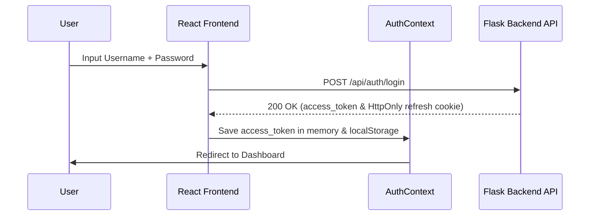

# Frontend Architecture Guide

This document describes the folder structure, layouts hierarchy, component layouts, routing guards, and development roadmap for the VeriSync Console.

---

## 1. Enterprise Folder Structure

The React 19 codebase follows a **Feature-Based Architecture** with clear boundaries between shared resources and feature components:

```
frontend/
├── config/                  # Global environment properties & Vite configurations
├── src/
│   ├── animations/          # CSS keyframe definitions or Framer-motion maps
│   ├── api/                 # Raw services endpoints connector hooks
│   ├── assets/              # Static media resources
│   ├── components/
│   │   ├── common/          # Reusable shared UI elements (DataTable, SearchBar)
│   │   └── layout/          # Layout blocks (Sidebar, Navbar, Guards)
│   ├── config/              # RBAC mappings and permission mappings
│   ├── constants/           # Global immutable dictionary constants
│   ├── context/             # Global Context providers (AuthContext)
│   ├── features/            # Feature-specific components and business modules
│   ├── hooks/               # Custom hooks mapping states (useAuth, usePermissions)
│   ├── layouts/             # Page layouts shells (DashboardLayout, AuthLayout)
│   ├── lib/                 # Third-party wraps config (Axios client instance)
│   ├── mocks/               # Mock data loaders for offline development
│   ├── pages/               # Route views placeholders
│   ├── providers/           # TanStack Query, Theme, Toast wrappers
│   ├── routes/              # Client routing rules
│   ├── store/               # Global state stores (Zustand, Context)
│   ├── styles/              # Global css and theme variables
│   ├── themes/              # Custom design system configurations
│   ├── tests/               # Front-end unit and integration tests
│   ├── App.jsx              # Application router and providers tree
│   ├── index.css            # Base styles and Tailwind imports
│   └── main.jsx             # Entry script mounting ReactDOM
```

---

## 2. Shared Layout Hierarchy

The application routing layouts nesting structure is mapped as follows:

```
App (Theme, Query, Toast, Auth Providers)
 ├── GuestRoute (Public routing)
 │    └── AuthLayout
 │         └── /login (Login Form Page)
 └── ProtectedRoute (Auth Session required)
      └── DashboardLayout
           ├── Navbar & Desktop/Mobile Sidebar
           ├── Breadcrumbs Navigation
           ├── Content Outlet
           │    ├── / (Dashboard Page)
           │    ├── /identities (Ingestion Listing)
           │    ├── /resolution (Matching engine Console)
           │    ├── /clusters (Clusters & Golden Profiles)
           │    ├── /users (RBAC Guarded operator list)
           │    └── /settings (Dynamic configuration policies)
           └── Footer
```

---

## 3. Global Design System & Component Library

The console layout implements a custom design system centered on Tailwind tokens:

### Typography
- Body font: `Inter`, sans-serif.
- Headings: Heavy tracking-wide uppercase typography.

### Button Variants
- **Primary**: Purple background (`bg-primary-600`), white text, shadow, rounded curves.
- **Secondary**: Outlined grey, hover background changes.

### Shadows & Curves
- Cards feature `shadow-soft` (`0 4px 20px -2px rgba(0, 0, 0, 0.05)`) and `rounded-premium` (`12px`) border radius.

---

## 4. Custom Hook Mappings

- `useAuth`: Fetches username, role claims, and credentials from AuthContext.
- `usePermissions`: Evaluates RBAC permissions maps.
- `usePagination`: Maps tables paging offset boundaries.
- `useDarkMode`: Syncs dark/light modes.
- `useDebounce`: Debounces inputs.
- `useApi`: Simplifies request loading states.

---

## 5. Development Roadmap

1. **Phase 1: Scaffolding Setup (Completed)**: Initializing structure, libraries, providers, layouts, and page routing.
2. **Phase 2: Ingest & Registration Integration**: Hooking up React Hook Form and Zod validators to hit `/api/v1/identities/ingest`.
3. **Phase 3: Resolution Strategy Explorer**: Integrating TanStack Query to query candidate matching and displaying explainability trace breakdowns.
4. **Phase 4: Conflict Resolution Visualizer**: Building interactive side-by-side attributes comparison grids during cluster reviews.

---

## 6. Authentication & JWT Lifecycle Integration

### Authentication Flow Diagram


### JWT Lifecycle & Refresh Token Sequence
- **Access Tokens**: Short-lived (stored in memory/localStorage), attached to request headers as `Authorization: Bearer <token>`.
- **Refresh Tokens**: Long-lived, stored securely in an `HttpOnly`, `SameSite=Strict`, `Secure` cookie.
- **Auto-Rotation**:
  ```mermaid
  sequenceDiagram
      participant Axios as Axios Interceptor
      participant API as Flask Backend
      
      Axios->>API: Request with Expired Access Token
      API-->>Axios: 401 Unauthorized
      Note over Axios: Lock queue to prevent duplicate refresh requests
      Axios->>API: POST /api/auth/refresh (Sends Cookie)
      API-->>Axios: 200 OK (New Access Token)
      Note over Axios: Resolve all queued requests with new token
      Axios->>API: Retry original request
  ```

### Route Protection & Session Management Flow
- **Protected Routes**: Checks if `isAuthenticated` state is active. If false, redirects to `/login` preserving the original route path in the location state object to support redirections back upon successful authorization.
- **Role & Permission Guards**: Checks logged-in operator claims. In case of matching mismatch, redirects session immediately to `/403` Access Denied.
- **Session Timeout (Idle Detection)**:
  - Tracks user activity listeners (`mousemove`, `keydown`, `click`, `scroll`).
  - Triggers a session warning modal at 14 minutes.
  - Automatically logs out user and invalidates tokens after 15 minutes of idle state.
  - Synchronizes login/logout events across browser tabs using the Storage API.


## 7. Dashboard Architecture

### Dashboard Component Hierarchy
```
Dashboard Page (src/pages/Dashboard.jsx)
 ├── Top Bar Panel (Search Input + Refetch Trigger)
 ├── 10 KPI Stats Cards Grid (Total metrics + trend sparklines)
 ├── Main Analytics Panels (12-column grid layout)
 │    ├── Line Chart: Identity Ingest trends
 │    ├── Doughnut Chart: System Data source ratios
 │    ├── Stacked Bar Chart: Merge compliance ratios
 │    ├── Bar Chart: Match similarity distributions
 │    ├── Pie Chart: Match verification validations
 │    └── Line Chart: Real-time API Latency timeline
 └── Diagnostic Metrics Board (DB connections, memory, CPU telemetry)
```

### Telemetry Query Lifecycle Flow
- **Parallel Fetching**: Executes `useQuery` calls in parallel to retrieve `/api/v1/system/stats` and `/api/v1/system/health` independently, preventing loading cascades.
- **Refetch Interval Polling**: Diagnostics component runs on a strict `10000ms` (10s) reload schedule, pinging `/api/v1/system/health` to update database connectivity parameters.
- **Global Debounced Search**: Listens to query input changes, debounces triggers by `400ms`, and fires index lookups to map identity paths.


## 8. User & Organization Management

### Component Architecture Hierarchy
```
User List View (src/pages/Users.jsx)
 ├── Export CSV button / Reload triggers
 ├── SearchBar + Status/Roles filtering Panel
 ├── Bulk Actions Control Bar (Bulk status shifts, delete triggers)
 ├── DataTable component (Sticky headers, multi-select checkboxes)
 ├── Create Operator Drawer Form (React Hook Form + Zod validator)
 └── Edit Operator Details Drawer
```

### CRUD Query Invalidation Loops
- **Access Bounds (RBAC Flow)**: Action buttons (Create, Edit, Delete, Bulk actions) conditionalize their visibility by asserting `canWriteUsers` hook checks. List endpoints scopes display parameters globally for `Super Admin` and filter by organization context for `Organization Admin`.


## 9. Identity Registration & Ingestion

### Component Architecture Hierarchy
```
Bulk Upload View (src/pages/BulkRegistration.jsx)
 ├── CSV Template Downloader Button
 ├── CSVUploader component (Drag & Drop + pre-validation parsing)
 ├── CSVPreviewTable component (Renders 5 rows sample preview)
 ├── DuplicatePreviewModal (UID warnings overlay checker)
 └── UploadProgressDialog & ImportSummary panels
```

### Ingestion Lifecycle Flow
1. **Drag-and-Drop Parsing**: Client-side parsing reads CSV headers, validating mandatory keys (`system_source`, `system_uid`, `organization_id`, `name`) before rendering tables.
- **Queue Mutations & Cache updates**: POSTs to `/api/v1/identities/ingest/bulk`. Success triggers automatically call `invalidateQueries(['identities'])` to sync lists dashboards telemetry.


## 10. Identity Resolution Workspace

### Component Architecture Hierarchy
```
Resolution Console (src/pages/IdentityResolution.jsx)
 ├── CommandPalette Ctrl+K modal overlay
 ├── ResolutionSearch & ResolutionFilters control panels
 ├── Split-pane split panels layout
 │    ├── Left: CandidateTable (lists score candidates, toggle pins)
 │    └── Right: ExplainabilityPanel (expandable logic accordions)
 └── MergePreviewDialog warnings confirm modal
```

- **Merge actions cache invalidations**: Calls `/api/v1/clusters/merge` mutation on merge confirm, and runs `.invalidateQueries(['candidatesList'])` to reload candidate list.


## 11. Cluster Management & Merge Transactions

### Component Architecture Hierarchy
```
Cluster Registry (src/pages/Clusters.jsx)
 ├── SearchBar + status dropdown Filters Panel
 ├── DataTable component (lists clusters and identities counts)
 └── MergeWizard Drawer sheet (7-Step Wizard Flow)
      ├── Steps 1-2: Source / Target inputs
      ├── Step 3: MergePreview (golden profiles comparison side-by-side)
      ├── Steps 4-5: Merge Policy & Rollback preview warnings
      └── Steps 6-7: Confirms and executes merge mutation
```

- **Rollbacks Preview validation**: Rollback targets execute `/api/v1/clusters/rollback/{uuid}` to fetch rollbacks safety reports.


## 12. Verification & Audit Operations

### Component Architecture Hierarchy
```
Verification Dashboard (src/pages/Verification.jsx)
 ├── FilterPanel (COMPLETED, PENDING, FAILED select lists)
 ├── DataTable component (lists requests logs)
 └── VerificationWizard Drawer (7-Step Decision Workflow)
      ├── Steps 1-2: Review Request & Compare candidates details
      ├── Steps 3-4: Explainability & Golden Profile previews
      ├── Steps 5-6: Operator Decision (Approved/Rejected selections) & Confirmations
      └── Step 7: Executes verification decision mutation
```

### Invalidation & Cache Strategy
- **Verification decision invalidations**: Submitting verification actions triggers `.invalidateQueries` calls to reload `['verificationHistory']`, `['verificationDetails']`, `['dashboardStats']`, `['clustersList']`, `['clusterDetails']`, `['resolutionHistory']`, `['auditLogs']`, and `['systemHealth']` queries.
- **Audit Diff Timelines**: `AuditLogs.jsx` visualizes change logs utilizing `AuditTimeline.jsx` and `AuditDiffViewer.jsx` layout diff grids.


## 13. System Administration, Monitoring & Settings

### Component Architecture Hierarchy
```
System settings (src/pages/SystemSettings.jsx)
 ├── SettingsGrid component (General, JWT, auth categories inputs)
 └── SettingsDiffModal confirm overlay (pre-submit validation comparison)

Monitoring dashboard (src/pages/Monitoring.jsx)
 └── TelemetryCharts component (CPU usage, Memory utilization timelines)

Logs Viewer console (src/pages/LogsViewer.jsx)
 └── LogsTable component (expanded line detail traces payloads)
```

### Invalidation & Cache Strategy
- **Diagnostics auto-refresh polling**: Monitoring charts query `/api/v1/system/health` on a strict 10s reload schedule to trace connections status live.


## 14. Production Hardening, DevOps & Deployment

### Production Container Pipeline
```
Code Repository
 └── GitHub Actions Pipeline (.github/workflows/deploy.yml)
      ├── Backend Pytest & Linting check
      └── Frontend Vite production bundle & Vitest test suites
```

### Server Reverse Proxy Topology
```
HTTP Requests (Port 80)
 └── Nginx Reverse Proxy (nginx.conf)
      ├── Static Assets delivery (try_files redirection fallback)
      └── Reverse Proxy Forward (/api/ -> http://backend:5000)
```
- **Security hardening**: Custom Nginx server blocks inject HTTP headers (CSP, HSTS, XSS-Protection) and enforce request rate limits.


