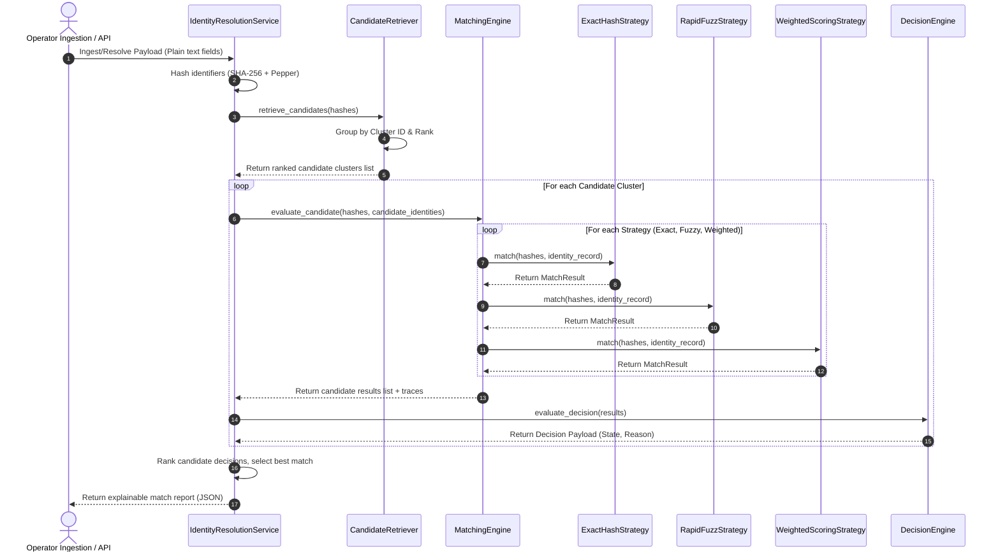

# Identity Resolution & Merge Engine Documentation

This document describes the design architecture, strategy pipeline, candidate retrieval process, decision flow, weighted scoring calculations, and merge policy evaluation for VeriSync.

---

## 1. Engine Core Pipeline Flow

The engine implements a decoupled strategy pipeline pattern to process match decisions:



---

## 2. Decision Flow and Confidence Thresholds

The `DecisionEngine` interprets the confidence score generated by matching strategies and maps it to a lifecycle state:

```
[ Incoming Payload ]
        │
        ▼
   [ Hashing ] ──► [ Candidate Retrieval ]
                          │
                          ▼
            [ Execute Strategies Pipeline ] ──► [ Max Confidence Score ]
                                                         │
       ┌───────────────────┬─────────────────────────────┼─────────────────────────┐
       ▼                   ▼                             ▼                         ▼
   [ 100.0% ]       [ 85.0% - 99.9% ]             [ 50.0% - 84.9% ]            [ < 50.0% ]
       │                   │                             │                         │
       ▼                   ▼                             ▼                         ▼
 EXACT_MATCH     HIGH_CONFIDENCE_MATCH            MANUAL_REVIEW               NEW_CLUSTER
```

### Threshold Configurations
- **EXACT_MATCH** (Score: `100.0`): Automatically resolves and links the incoming record to the candidate cluster. Occurs when a unique deterministic identifier (Aadhaar, ABHA, DigiLocker hash) matches.
- **HIGH_CONFIDENCE_MATCH** (Score: `85.0 - 99.9`): Resolves automatically. Occurs when multiple matching fields and weights exceed the automatic link threshold.
- **MANUAL_REVIEW** (Score: `50.0 - 84.9`): Flagged for administrative operator audit. Occurs when matching non-unique hashes (like Mobile or Email) match without a matching unique identifier.
- **NEW_CLUSTER** (Score: `< 50.0`): Low match likelihood. A new physical person cluster is created.

---

## 3. Weighted Scoring Pipeline and Formula

The `WeightedScoringStrategy` aggregates multiple comparison factors (Exact Hash, RapidFuzz, Metadata, Source reliability, Completeness) to output a single unified score:

### Scoring Formula:
\[S_{\text{final}} = \left( \frac{\sum_{i \in \text{active}} S_i \cdot W_i}{\sum_{i \in \text{active}} W_i} \right) \cdot R_{\text{source}} \cdot C_{\text{completeness}}\]

Where:
- \(S_i\) is the individual factor score (0.0 to 100.0).
- \(W_i\) is the normalized weight factor loaded from `system_settings` table.
- \(R_{\text{source}}\) is the candidate's source system reliability score (e.g. `1.0` for Aadhaar, `0.95` for ABHA).
- \(C_{\text{completeness}}\) is the profile completeness modifier, defined as:
  \[C_{\text{completeness}} = 0.80 + 0.20 \cdot \left( \frac{\text{Populated Fields}}{\text{Total Fields (8)}} \right)\]

---

## 4. Merge Policy Engine

The **Merge Policy Engine** evaluates whether two existing identity clusters are eligible to be merged based on match scores, metadata integrity, and system safety constraints. It does not perform changes to the database.

### Merge Policy Validation Flow:
```
 [ Source Cluster ] ──► [ Check Block Rules ] ──► [ Risk Evaluation ] ──► [ Final Decision ]
                               ▲                        ▲
                               │                        │
 [ Target Cluster ] ───────────┘             (Cross-org, LOCKED, etc.)
```

### Risk Level Classification Matrix
- **LOW_RISK**: Match score \(\ge 90.0\), clusters share the same organization, and both are in `OPEN` status.
- **MEDIUM_RISK**: Match score falls between \(70.0\) and \(89.9\) OR clusters belong to different organizations (when cross-org is enabled) OR one of the clusters is currently `LOCKED` or `MATCHED`.
- **HIGH_RISK**: Any validation constraint / block rule is violated, or version mismatches occur, or unique ID mismatch occurs.

### Merge Decision Status Matrix
- **AUTO_MERGE**: Eligible to merge automatically. Score \(\ge 90.0\) and risk is `LOW_RISK`.
- **HIGH_CONFIDENCE_REVIEW**: High match score (\(\ge 90.0\)) but flags `MEDIUM_RISK` warning factors (e.g., cross-organization boundaries or `LOCKED` cluster status).
- **MANUAL_REVIEW**: Score between \(70.0\) and \(89.9\). Requires administrative review.
- **BLOCKED**: Merge cannot proceed. Triggered by low match scores, self-merges, version conflicts, mismatched unique IDs, circular merge loops, or cross-org boundary when disabled.
- **ROLLBACK_REQUIRED**: Inconsistent states. Occurs if one or both clusters are already marked as `MERGED` indicating conflict loops or a past merge needs to be undone.

---

## 5. Database Settings Configurations

You can dynamically adjust weights and thresholds using the `system_settings` table:

| Setting Key | Default Value | Description |
| :--- | :--- | :--- |
| `weight_factor_aadhaar` | `0.25` | Weight for Aadhaar Unique Hash match |
| `weight_factor_abha` | `0.20` | Weight for ABHA Unique Hash match |
| `weight_factor_digilocker` | `0.15` | Weight for DigiLocker Unique Hash match |
| `weight_factor_mobile` | `0.10` | Weight for Mobile phone matching |
| `weight_factor_email` | `0.05` | Weight for Email address matching |
| `weight_factor_full_name` | `0.10` | Weight for RapidFuzz fuzzy name match |
| `weight_factor_address` | `0.10` | Weight for RapidFuzz fuzzy address match |
| `weight_factor_date_of_birth` | `0.05` | Weight for Date of Birth match |
| `merge_auto_threshold` | `90.0` | Threshold above which AUTO_MERGE is allowed |
| `merge_review_threshold` | `70.0` | Threshold above which MANUAL_REVIEW is allowed |
| `merge_allow_cross_org` | `False` | Whether cross-organization merges are enabled |
